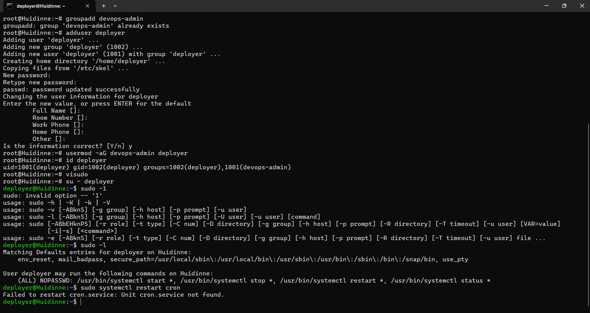
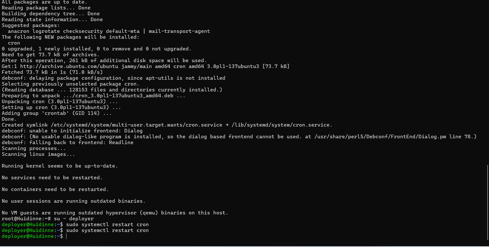

# Bài 2: Cấu hình phân quyền Nhóm và sudoers bằng visudo

## 1. Mục tiêu

* Tạo group `devops-admin`.
* Tạo user `deployer`.
* Thêm user `deployer` vào group `devops-admin`.
* Cấu hình sudoers để các thành viên của group `devops-admin` được phép sử dụng một số lệnh `systemctl`.
* Các lệnh được cấp quyền không yêu cầu nhập mật khẩu thông qua `NOPASSWD`.
* Kiểm tra quyền bằng `sudo -l` và thử restart dịch vụ `cron`.

## 2. Tạo group

Tạo group `devops-admin`:

```bash
sudo groupadd devops-admin
```

Kiểm tra:

```bash
getent group devops-admin
```

## 3. Tạo user và thêm vào group

Tạo user `deployer`:

```bash
sudo adduser deployer
```

Thêm user vào group `devops-admin`:

```bash
sudo usermod -aG devops-admin deployer
```

Kiểm tra:

```bash
groups deployer
```

Kết quả cho thấy user `deployer` thuộc group `devops-admin`.

## 4. Cấu hình sudoers

Kiểm tra đường dẫn của `systemctl`:

```bash
which systemctl
```

Kết quả:

```text
/usr/bin/systemctl
```

Mở file sudoers bằng `visudo`:

```bash
sudo visudo
```

Thêm dòng cấu hình:

```text
%devops-admin ALL=(ALL) NOPASSWD: /usr/bin/systemctl start *, /usr/bin/systemctl stop *, /usr/bin/systemctl restart *, /usr/bin/systemctl status *
```

Trong đó:

* `%devops-admin`: áp dụng quyền cho tất cả user thuộc group `devops-admin`.
* `ALL=(ALL)`: cho phép thực thi với quyền của các user trên hệ thống.
* `NOPASSWD`: không yêu cầu nhập mật khẩu khi sử dụng các lệnh được cấp quyền.
* `systemctl start *`: cho phép khởi động dịch vụ.
* `systemctl stop *`: cho phép dừng dịch vụ.
* `systemctl restart *`: cho phép khởi động lại dịch vụ.
* `systemctl status *`: cho phép kiểm tra trạng thái dịch vụ.

## 5. Kiểm tra bằng user deployer

Chuyển sang user `deployer`:

```bash
su - deployer
```

Kiểm tra user hiện tại:

```bash
whoami
```

Kết quả:

```text
deployer
```

Kiểm tra quyền sudo:

```bash
sudo -l
```

Kết quả hiển thị quyền:

```text
(ALL) NOPASSWD: /usr/bin/systemctl start *,
(ALL) NOPASSWD: /usr/bin/systemctl stop *,
(ALL) NOPASSWD: /usr/bin/systemctl restart *,
(ALL) NOPASSWD: /usr/bin/systemctl status *
```

## 6. Kiểm tra restart dịch vụ cron

Thực hiện:

```bash
sudo systemctl restart cron
```

Lệnh thực hiện thành công mà không yêu cầu nhập mật khẩu của user `deployer`.

Kiểm tra trạng thái dịch vụ:

```bash
sudo systemctl status cron
```

Kết quả cho thấy dịch vụ `cron` đang hoạt động:

```text
Active: active (running)
```

## 7. Kết quả

Đã hoàn thành các yêu cầu:

* Tạo group `devops-admin`.
* Tạo user `deployer`.
* Thêm `deployer` vào group `devops-admin`.
* Cấu hình sudoers bằng `visudo`.
* Cho phép group `devops-admin` thực hiện các lệnh `systemctl start`, `stop`, `restart`, `status`.
* Các lệnh được cấp quyền sử dụng `NOPASSWD`.
* User `deployer` có thể restart dịch vụ `cron` mà không cần quyền root toàn phần.

## 8. Minh chứng

### Kết quả `sudo -l`





### Dòng cấu hình sudoers

```text
%devops-admin ALL=(ALL) NOPASSWD: /usr/bin/systemctl start *, /usr/bin/systemctl stop *, /usr/bin/systemctl restart *, /usr/bin/systemctl status *
```
